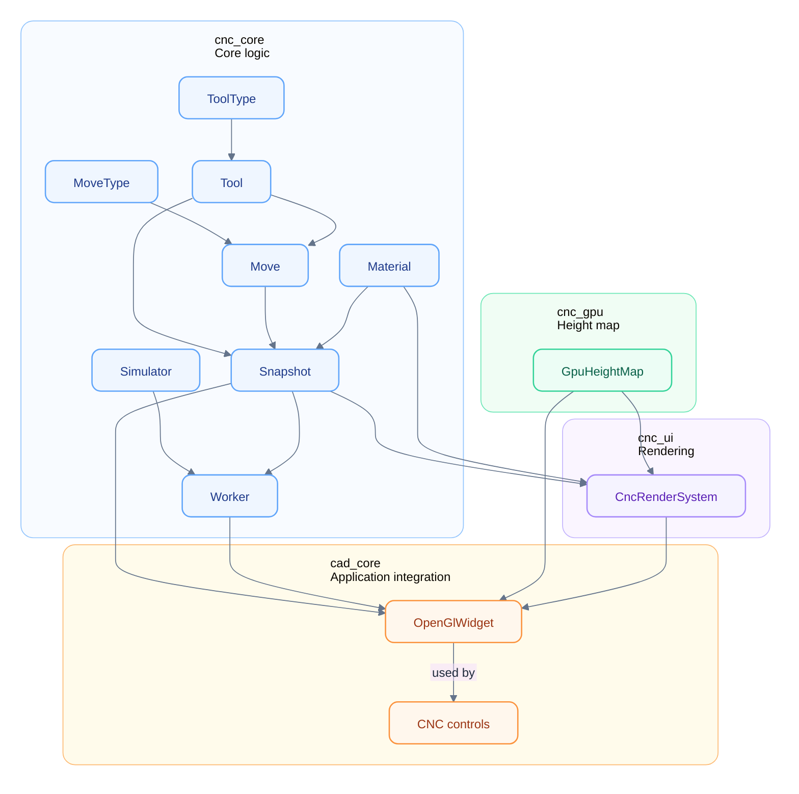

## CNC Simulator
The CNC simulator is split across four libraries:
- `cnc_core` &mdash; core CNC logic and types, in `src/cnc`. This includes the following parts:
  - core CNC types and parsing implementation:
    - [MoveType](../src/cnc/include/cnc/program/MoveType.hxx) &mdash; move type: rapid or cutting
    - [Move](../src/cnc/include/cnc/program/Move.hxx) &mdash; one linear machine move
    - [Tool](../src/cnc/include/cnc/program/Tool.hxx) &mdash; tool description: type and diameter
    - [ToolType](../src/cnc/include/cnc/program/ToolType.hxx) &mdash; tool geometry: ball or flat
    - [Program](../src/cnc/include/cnc/program/NcProgram.hxx) &mdash; parsed NC program data and parser entry points
    - [Material](../src/cnc/include/cnc/Material.hxx) &mdash; stock and height-map grid configuration
    - [ToolpathFit](../src/cnc/include/cnc/ToolpathFit.hxx) &mdash; helpers to compute toolpath bounds and fit stock around them
    - [Snapshot](../src/cnc/include/cnc/Snapshot.hxx) &mdash; immutable snapshot of the current simulation state; does not hold the height map
    - [Simulator](../src/cnc/include/cnc/Simulator.hxx) &mdash; CPU-side toolpath timeline; produces snapshots and cutter moves
    - [Worker](../src/cnc/include/cnc/Worker.hxx) &mdash; owns the `Simulator` on a worker thread and publishes snapshots plus cutter moves for the GPU
- `cnc_gpu` &mdash; GPU height map:
    - [GpuHeightMap](../src/cnc_gpu/include/cnc_gpu/GpuHeightMap.hxx) &mdash; owns the height-map textures and applies cutter moves to them
- `cnc_ui` &mdash; rendering:
    - [CncRenderSystem](../src/cnc_ui/include/cnc_ui/CncRenderSystem.hxx) &mdash; builds the stock, path, and tool meshes and renders them
- `cad_core` &mdash; CNC panel and integration with the existing CAD project:
    - [CncPanelWidget](../src/cad/src/gui/toolbars/cnc/CncPanelWidget.hxx) &mdash; CAD-side control panel for the CNC simulator
    - [OpenGlWidget](../src/cad/src/OpenGLWidget.hpp) &mdash; CAD viewport; owns the CNC state and polls the worker on a timer

### System overview
The worker owns the simulation timeline and is the source of truth for tool
positioning and playback state. It does not own the stock geometry: the height
map lives on the GPU and is updated by applying cutter moves to it.

`OpenGlWidget` coordinates the parts. A 16 ms timer polls the worker for the
latest snapshot and drains its queued cutter moves into a local pending queue.
During `paintGL`, those moves are applied to the GPU height map in batches, and
`CncRenderSystem` draws the resulting stock, toolpaths, and tool. The CAD UI
refreshes from the latest CPU snapshot.

The Mermaid diagram below shows how the parts interact. Arrows are dependency arrows, not data-flow arrows: `A --> B` means B depends on A.

`main` is the composition root: it creates `OpenGlWidget` and `CncPanelWidget`,
passes the widget into the panel, and registers the panel with
`SubdividedPanelBar` through its `ToolPanelWidget` base. The panel calls the
widget directly; `OpenGlWidget` never refers back to the panel or to
`ToolPanelWidget`.
